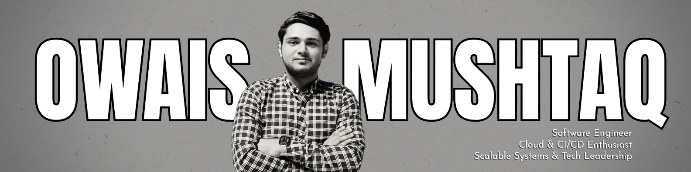

  

## Hi, I'm Owais

Senior Software Engineer and tech lead with 4+ years building **wealth-management FinTech** for US advisory firms at **Matrix Systems (Pvt.) Ltd**, the Karachi team behind **[SoftPak](https://www.softpak.com/)**'s products. I lead a team of five and stay hands-on across backend, frontend, data, cloud and delivery: I write code, review and merge pull requests, and own releases.

I modernize legacy systems, build new products from scratch, and keep improving what's already running. My rule for the AI era: **pace through AI, quality through experience**.

> My day-to-day commits, reviews and merges live in private company repositories under **[@owais-matrix](https://github.com/owais-matrix)**.

### What I bring

- **Modernization without big-bang risk.** Rebuilt a legacy Jersey backend as Spring Boot APIs that serve two products, with a backend-for-frontend layer so the existing UI runs on the new APIs and QA signs off before cutover. Also moved C++ (MFC) utilities to Azure and upgraded Angular 12 to 15.
- **Backends built to scale.** RabbitMQ in place of hand-managed threads, Java's FFM API in place of fragile JNI, multi-tenancy, Keycloak SSO and MFA, audit trails, and complete Swagger documentation.
- **Complete frontends.** Full Angular applications from Figma to production, including micro-frontends with Module Federation, a shared component library, and data-heavy grids and charts.
- **Fast, reliable data.** Cut a rebalancing job from **10 minutes to under 1 second** across 2,000+ proposals; moved scripts and triggers to Liquibase; added BCP bulk loading of client files into cloud databases; built JasperReports for portfolio managers.
- **Delivery on any platform.** End-to-end pipelines with Jenkins, GitHub Actions or Bitbucket Pipelines: build, Docker, deployment to dev, QA, UAT and production on AWS and Azure Kubernetes Service, with SonarCloud and JaCoCo quality gates and release notifications.
- **AI-first engineering, without lowering the bar.** Evaluated Junie, Codex, Claude, GitHub Copilot and Cursor with my team before standardizing on Claude. Wrote repository guidelines for coding, reviews, testing and AI agents, so developers ship from a Jira ticket with minimal rework. Every PR passes automated review, then mine for business logic, performance and consistency.
- **Leadership and process.** Mentoring, estimation and work breakdown, Agile delivery with US clients, and process work behind the company's CMMI Level 3 appraisal and ISO 9001 audits, backed by my MS in Software Project Management.

### Products I've worked on

| Product | What it is | My part |
|---|---|---|
| [uRebal](https://www.softpak.com/solutions/universal-rebalancer/) | Portfolio rebalancing and trading | Tech lead and architect of the backend modernization |
| [uRebal Hub](https://www.softpak.com/solutions/urebal-hub/) | SaaS wealth-management platform for RIAs | API integration and release notes for the platform team |
| [Advisor Sketchbook](https://partipris-invest.com/advisor-wealthdesign/) | Multi-tenant SaaS for financial advisors | Co-architect from requirements to MVP |
| [MARS](https://www.softpak.com/solutions/managed-accounts-rebalancing-system/) | Managed account rebalancing | Performance tuning and cloud migration |

### Research

- **[AI-Augmented Agile MVP Development for Lean Tech Startups](https://doi.org/10.21203/rs.3.rs-10346557/v1)** (2026, sole author). Under review at *Innovations in Systems and Software Engineering* (Springer).
- **Rural working women's lived experiences of sustainable development in Pakistan's date palm industry** (2026, co-author). A funded field study, under review.
- **[Vision-Based Human Activity Recognition](https://github.com/muhammadowaismushtaq/researches/tree/main/vision-based-human-activity-recognition)** (2022). Deep learning on video, my final year project at FAST-NUCES.

<!-- ORCID: [0009-0001-7726-7200](https://orcid.org/0009-0001-7726-7200) -->

---

<b>Modernizing a legacy system, adopting AI safely, or tightening delivery?</b> I'm always happy to talk. Reach me through the links on my profile.

